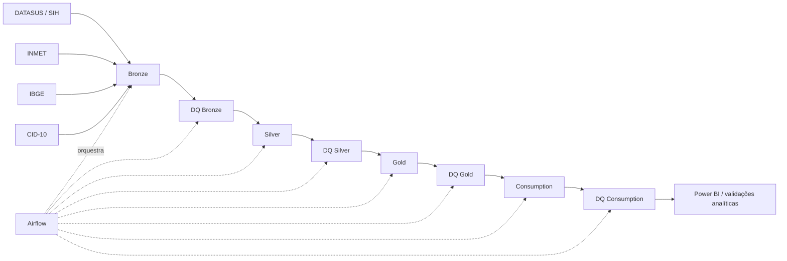

# Pipeline de Dados — TCC

Pipeline de Engenharia de Dados para integração de internações hospitalares,
meteorologia, municípios e classificação CID-10 no estado de São Paulo. O
período analítico é de **01/01/2015 a 31/12/2025**. As competências SIH
alcançam 2026 para capturar apresentações tardias de internações ocorridas em
2025; o INMET começa tecnicamente em 25/12/2014 para suportar o lag D-7.

## Status atual

| Componente | Status |
|---|---|
| Bronze | Implementada |
| Silver | Implementada |
| Gold | Implementada |
| Data Quality Bronze, Silver e Gold | Implementado e aprovado |
| Spark e Docker | Implementados |
| Airflow | Implementado, com gates por camada |
| Consumption e DQ | Implementados |
| Power BI | PBIP/TMDL implementado |

Execução validada em 01/10/2026: 27.671.456 internações no recorte analítico,
2.591.610 linhas em `fato_municipio_dia`, 21.751.139 linhas em
`fato_municipio_dia_cid` e 34 testes automatizados aprovados. O DQ final de
Consumption terminou em `PASS`.

## Arquitetura



- **Bronze:** preserva os arquivos brutos recebidos.
- **Silver:** tipa, limpa, padroniza e agrega os dados.
- **Gold:** integra dimensões e fatos para consumo analítico.
- **Data Quality:** aplica controles específicos depois de cada camada.

O desenho detalhado está em
[`docs/assets/arquitetura_pipeline.png`](docs/assets/arquitetura_pipeline.png).

## Fontes

- DATASUS/SIH: internações hospitalares mensais em DBC.
- INMET: observações meteorológicas anuais em ZIP/CSV.
- IBGE: malha municipal de São Paulo de 2022.
- CID-10: capítulos, grupos, categorias e subcategorias.

## Configuração temporal

`src/common/study_period.py` é a fonte única de datas, anos, competências e
cardinalidade do calendário. Os defaults podem ser substituídos pelas variáveis
`TCC_ANALYSIS_START`, `TCC_ANALYSIS_END`, `TCC_SIH_COMPETENCE_START` e
`TCC_SIH_COMPETENCE_END` em reprocessamentos controlados.

Os quatro níveis de DQ utilizam `ERROR`, `WARNING` e `INFO`. Apenas falhas
`ERROR` interrompem o processo. Cobertura meteorológica é registrada como
métrica, pois valores ausentes podem ser uma característica da fonte.

## Estrutura

```text
src/
├── bronze/
├── silver/
├── gold/
├── consumption/
├── audit/
├── validation/
├── common/
│   ├── study_period.py
│   └── validators.py
└── quality/
    ├── bronze/
    ├── silver/
    ├── gold/
    └── consumption/
```

Os parâmetros de qualidade da Silver e da Gold ficam nos respectivos arquivos
`quality_config.py`. Os validadores Spark reutilizáveis ficam em
`src/common/validators.py`.

## Ambiente Docker

Suba o ambiente na raiz do projeto:

```powershell
docker compose up -d
```

O JupyterLab fica disponível em `http://localhost:8888`.

## Data Quality Bronze

```powershell
docker compose exec -T spark /opt/conda/bin/python src/quality/bronze/dq_sih.py --ano-inicio 2015 --mes-inicio 1 --ano-fim 2026 --mes-fim 7
docker compose exec -T spark /opt/conda/bin/python src/quality/bronze/dq_inmet.py --ano-inicio 2014 --ano-fim 2025
docker compose exec -T spark /opt/conda/bin/python src/quality/bronze/dq_ibge.py --ano 2022
docker compose exec -T spark /opt/conda/bin/python src/quality/bronze/dq_cid10.py
```

A Bronze verifica chegada, arquivos vazios, integridade do formato,
legibilidade, completude temporal, duplicidade por conteúdo e downloads
interrompidos. Não aplica regras analíticas.

## Data Quality Silver

```powershell
docker compose exec -T spark spark-submit src/quality/silver/dq_sih.py
docker compose exec -T spark spark-submit src/quality/silver/dq_ibge.py
docker compose exec -T spark spark-submit src/quality/silver/dq_cid10.py
docker compose exec -T spark spark-submit src/quality/silver/dq_inmet.py
docker compose exec -T spark spark-submit src/quality/silver/dq_inmet_diario.py
```

A Silver verifica schema, tipos, quantidades, chaves, nulos, domínios,
padronização, períodos e cobertura.

## Data Quality Gold

```powershell
docker compose exec -T spark spark-submit src/quality/gold/dq_municipio_estacao.py
docker compose exec -T spark spark-submit src/quality/gold/dq_fato_internacao.py
docker compose exec -T spark spark-submit src/quality/gold/dq_fato_internacao_meteorologia.py
```

A Gold verifica cardinalidade, preservação do volume, integridade dos joins,
granularidade, coerência dos indicadores meteorológicos e cobertura por
internação.

## Consumption e validação analítica

```powershell
docker compose exec -T spark spark-submit src/consumption/build.py
docker compose exec -T spark spark-submit src/quality/consumption/dq_consumption.py
docker compose exec -T spark spark-submit src/consumption/dashboard_analytics.py
docker compose exec -T spark spark-submit src/quality/consumption/dq_dashboard_analytics.py
docker compose exec -T spark spark-submit src/validation/research_questions.py
```

`fato_municipio_dia` é um painel completo de 645 municípios por 4.018 dias.
Ausência de AIH, depois da ingestão completa das competências, é representada
por zero nas métricas de saúde; ausência meteorológica continua `NULL`. A
estação é escolhida por município e ano, com cobertura histórica auditável.
Os lags D-1, D-3 e D-7 usam a data civil exata e a estação municipal válida
na data-alvo, inclusive quando a estação muda na virada do ano.

As validações independentes do Power BI são materializadas em
`data/validation/perguntas_pesquisa`, incluindo aberturas CID próprias por
capítulo, grupo e categoria, estratos de idade/sexo, lags e município.

As tabelas compactas utilizadas pelas seis páginas do Power BI ficam em
`data/consumption/dashboard_analytics`. Elas preservam o painel município-dia
como denominador e atribuem o mesmo peso a cada município elegível. A geração
e seu DQ fazem parte do TaskGroup `consumption` da DAG.

## Spark-submit

`spark-submit` inicia uma aplicação Spark e configura Java, classpath e
PySpark. Por isso ele é usado nos DQs Silver e Gold. Os DQs Bronze usam Python
diretamente porque trabalham principalmente com arquivos brutos.

## Relatório do projeto

O relatório consolidado da evolução 2015–2025 fica em
[`docs/Relatorio_Evolucao_2015_2025.md`](docs/Relatorio_Evolucao_2015_2025.md).

A auditoria metodológica das métricas, incluindo composição municipal,
denominadores CID, lags e estratificação por sexo, está documentada em
[`docs/Relatorio_Auditoria_Metricas_Analiticas.md`](docs/Relatorio_Auditoria_Metricas_Analiticas.md).

A comparação intramunicipal específica de D0, D-1, D-3 e D-7 está em
[`docs/Relatorio_Auditoria_Lags_Intramunicipais.md`](docs/Relatorio_Auditoria_Lags_Intramunicipais.md).

A implementação do dashboard orientado às seis perguntas está documentada em
[`docs/Relatorio_Reformulacao_Dashboard_6_Perguntas.md`](docs/Relatorio_Reformulacao_Dashboard_6_Perguntas.md).
Os relatórios anteriores permanecem no repositório como evidência histórica da
versão 2023–2025.

## Limites metodológicos

As saídas descrevem associações observacionais, não efeitos causais. Não há
normalização populacional nem controle de sazonalidade epidemiológica,
circulação viral, demografia, infraestrutura hospitalar, condições
socioeconômicas, poluição ou outros fatores ambientais.
